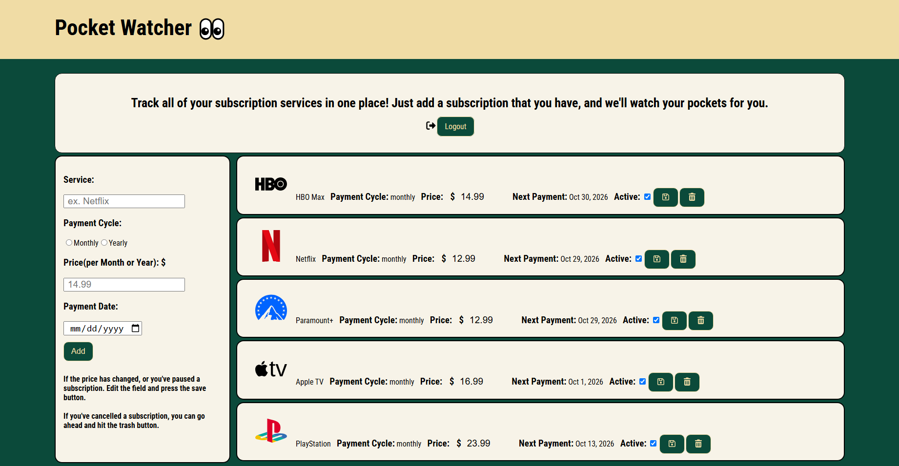

# PocketWatcher

A subscription tracker built with Node.js, Express, and MongoDB. Users sign up, log in, and keep track of all of their subscriptions in one place, like Netflix, HBO Max, Paramount+, Apple TV, and PlayStation.



## Features

- User signup and login with authentication
- Add a current subscription with the service name, payment cycle (monthly or yearly), price, and payment date
- View every subscription in a list with its price, payment cycle, and next payment date
- Update the price or active status of a subscription, like when you freeze or pause it, and save the change
- Delete any subscription you no longer want to track
- Log out when you're done

## Tech Stack

- HTML
- CSS
- JavaScript
- Node.js
- Express.js
- MongoDB

## Project Structure

```
.
├── public/
│   ├── images/
│   ├── styles.css
│   └── main.js
├── views/
├── .env
├── .gitignore
├── package.json
├── server.js
└── README.md
```

## Getting Started

### Prerequisites

- Node.js and npm
- MongoDB instance or MongoDB Atlas connection string

### Installation

```
npm install
```

### Environment Variables

Create a `.env` file in the project root with the following values:

```
DB_STRING=mongodb+srv://<username>:<password>@<cluster>/<database>?retryWrites=true&w=majority
SESSION_SECRET=your-session-secret
```

Replace the placeholders with your own database connection details and a secret of your choosing.

### Run the app

```
node server.js
```

The app runs on port `8080` by default.

## Usage

1. Open the app in your browser.
2. Sign up for an account or log in.
3. Fill out the form on the left with the service, payment cycle, price, and payment date, then hit Add.
4. If the price changes or you pause a subscription, edit the price or uncheck Active and press the save button.
5. If you cancel a subscription, hit the trash button to delete it.
6. Log out when you're finished.
